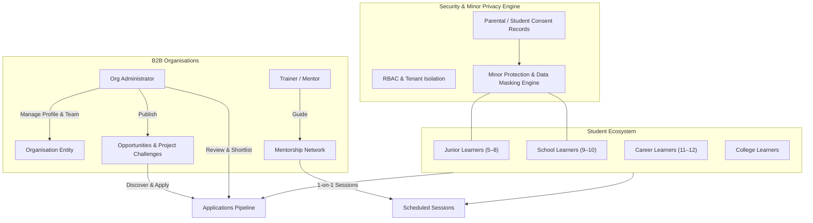

# Capacity Connect B2B & Organisation Ecosystem — Implementation Report

**Project:** Digital Twin Verse (DTV)  
**Branch:** `feature/student-intelligence-ecosystem`  
**Phase:** 1.0 — Milestone 3  
**Status:** **COMPLETE & FULLY VALIDATED**  
**Automated Tests:** 24/24 Passed (52/52 Total across all Milestones)  
**Browser QA:** 5/5 Responsive Viewports Passed (0 Horizontal Overflow)

---

## 1. Executive Summary

**Capacity Connect** has been architected and implemented as a production-grade **B2B & Organisation Ecosystem** within Digital Twin Verse (DTV). It creates a structured, bidirectional bridge connecting student learners with schools, colleges, universities, corporate enterprises, and training institutions through verified opportunities, project challenges, talent discovery, and mentorship.

Capacity Connect seamlessly builds on:
1. **Student Intelligence System (Milestone 1):** Multi-segment profiles (Junior, School, Career, Professional), verified skills, XP points, and interests.
2. **Dynamic Learning Roadmap Engine (Milestone 2):** 6-month adaptive development roadmaps, milestones, and weekly tasks.
3. **Multi-Tenant Foundation (`migrations/012_capacity_connect_foundation.sql`):** Granular role-based access control (`ORGANIZATION_ADMIN`, `TRAINER`, `TRAINEE`), strict tenant data isolation, and IDOR prevention.

---

## 2. Core Functional Modules



### Module 1: Organisation Management & Verification Workflow
- **Multi-Type Support:** Native support for 5 distinct organisation categories:
  - `school` (K-12, Classes 5–10)
  - `college` (Junior College, Classes 11–12, Polytechnic)
  - `university` (Higher Education, Undergraduate & Postgraduate)
  - `company` (Corporate Enterprises, Tech Startups, Industry Partners)
  - `training_institution` (Vocational Bootcamps, Specialized Academies)
- **Onboarding Flow:** Registration auto-generates slug, seeds initial state to `pending`, and grants the registering user `ORGANIZATION_ADMIN` permissions.
- **Verification Workflow:** Two-step administrative verification gate. Platform administrators review credentials and update status to `verified` or `rejected` with recorded audit notes and timestamp.

### Module 2: Organisation Dashboard & Real Computed DB Metrics
- **Zero Synthetic Metrics:** All dashboard indicators are computed directly from live PostgreSQL database rows via parameterized aggregation queries:
  - **Active Opportunities & Published Challenges:** Filtered by `status = 'published'`.
  - **Candidate Talent Pool:** Distinct count of engaged learners.
  - **Applications Pipeline Funnel:** Real-time breakdown across `submitted`, `reviewing`, `shortlisted`, `accepted`, `rejected`, and `withdrawn`.
  - **Acceptance / Conversion Rate:** Empirical percentage of accepted applications.
  - **Mentorship Activity:** Active mentor count, completed sessions, and student feedback rating average (out of 5.0).
  - **Candidate Skill Distribution:** Top skills aggregated across applicants.

### Module 3: Student Discovery & Minor Privacy Protection
- **Comprehensive Exploration:** Verified organisations can search and discover candidates filtered by skills (e.g. Python, AI, Robotics), student segment, and target career trajectories.
- **Strict Minor Protection Policy (Under 18 / Junior & School Segments):**
  - **Junior (Classes 5–8) and School (Classes 9–10):** Sensitive contact information (`email` and `phone`) is **automatically masked** (e.g. `aar***@***.com` and `[Protected Minor Contact]`).
  - **Display Name Masking:** Minimizes identity exposure (`Aarav J. [Protected Minor]`).
  - **Consent Exception:** If verified parental / student consent is explicitly recorded in `capacity_student_consents`, contact details are securely presented to verified organisations.
  - **Preserved Development Artifacts:** Skills, verified proficiencies, XP points, and learning progress remain visible to ensure meritocratic evaluation without compromising child safety.

### Module 4: Opportunity & Challenge Management
- **Opportunity Types:**
  1. `project_challenge`: Real-world problem statements and simulation sprints.
  2. `skill_programme`: Structured cohort development programs.
  3. `internship`: Practical work experience with stipends.
  4. `workshop`: Hands-on technical sessions.
  5. `competition`: Hackathons and contests with awards.
  6. `learning_opportunity`: Curated courses and guided explorations.
- **Structured Fields:** Title, Type, Eligibility Segments, Required Skills, Stipend/Reward, Location Type (Remote, Hybrid, On-site), Application Deadline, Max Capacity, and Status (`draft`, `published`, `closed`, `archived`).

### Module 5: Student Application Pipeline & Withdrawal System
- **Application Submission:** Students submit personalized motivation notes and portfolio/GitHub links.
- **Idempotency & Duplicate Guard:** Unique constraint `(opportunity_id, student_id)` prevents spam submissions. Re-application is supported only if previously withdrawn.
- **Organisation Review:** Organisations can update application status (`reviewing`, `shortlisted`, `accepted`, `rejected`) and leave direct reviewer feedback.
- **Withdrawal Workflow:** Students can withdraw applications while in `submitted` or `reviewing` status. Applications already `accepted` or `rejected` cannot be withdrawn (fail-closed HTTP 400). Withdrawn applications cannot be altered by the organisation.

### Module 6: Mentorship & Guidance System
- **Organisation Mentors:** Registry of active mentors with expertise areas, titles, and maximum mentee capacities.
- **Session Scheduling:** Structured booking with agenda, scheduled date/time, duration (minutes), meeting link, and notes.
- **Outcome Logging:** Mentors log outcome summaries upon session completion.
- **Student Rating & Feedback:** Students submit 1 to 5 star ratings and qualitative notes after completion.

### Module 7: Strategic Insights & Analytics
- **Pipeline Conversion:** Metrics on application acceptance rates and stage drop-offs.
- **Segment Participation:** Breakdown of candidate applications by segment.
- **Mentoring Hours Delivered:** Real sum of completed guidance sessions.

---

## 3. Database Migration Architecture

The ecosystem schema is deployed via [migrations/033_capacity_connect_ecosystem.sql](file:///c:/Users/Kumar%20Kartikey/.vscode%20DTwin/migrations/033_capacity_connect_ecosystem.sql):

| Table | Purpose | Key Constraints & Indexes |
| :--- | :--- | :--- |
| `organizations` *(extended)* | Multi-tenant root entity with B2B attributes | `org_type CHECK (...)`, `verification_status CHECK (...)` |
| `capacity_opportunities` | Project challenges, internships & programmes | Indexed by `(organization_id, status)`, `(opportunity_type, status)` |
| `capacity_applications` | Student opportunity applications & decisions | Unique `(opportunity_id, student_id)`, Indexed by `student_id`, `status` |
| `capacity_mentors` | Roster of verified organisation mentors | Unique `(organization_id, user_id)`, Indexed by `(organization_id, is_active)` |
| `capacity_mentorship_requests`| Student-to-mentor guidance requests | Indexed by `(mentor_id, status)`, `(student_id, status)` |
| `capacity_mentorship_sessions`| Scheduled 1-on-1 sessions & outcomes | Indexed by `(mentor_id, status)`, `(student_id, status)`, `scheduled_at` |
| `capacity_student_consents` | Parental / student consent records for minors | Unique `(student_id, consent_type)` |

---

## 4. API Endpoints Reference Matrix

All endpoints are mounted under `/api/v1/capacity-connect`:

| Method | Endpoint | Access Level | Description |
| :--- | :--- | :--- | :--- |
| `GET` | `/organizations` | Public / Student | List verified partner organisations |
| `POST`| `/organizations` | Authenticated | Register new organisation (assigns creator `ORGANIZATION_ADMIN`) |
| `GET` | `/organizations/:id` | Org Member | Retrieve organisation profile details |
| `PUT` | `/organizations/:id` | Org Admin | Update organisation metadata and contact info |
| `POST`| `/organizations/:id/verify` | Platform Admin | Approve or reject organisation accreditation |
| `GET` | `/organizations/:id/dashboard`| Org Member | Retrieve computed real-time dashboard metrics |
| `GET` | `/organizations/:id/analytics`| Org Member | Retrieve pipeline analytics and mentoring hours |
| `GET` | `/organizations/:id/talent` | Org Member | Discover candidates with automated minor privacy masking |
| `POST`| `/organizations/:id/opportunities`| Org Admin | Create and publish opportunity or project challenge |
| `PUT` | `/organizations/:id/opportunities/:oppId`| Org Admin | Update opportunity specifications |
| `GET` | `/opportunities` | Public / Student | Browse published opportunities filtered by segment & type |
| `GET` | `/opportunities/:oppId` | Public / Student | Retrieve opportunity details |
| `POST`| `/opportunities/:oppId/apply`| Student | Submit application with cover note and portfolio |
| `GET` | `/my-applications` | Student | List student's submitted applications & statuses |
| `POST`| `/applications/:appId/withdraw`| Student | Withdraw active application |
| `GET` | `/organizations/:id/applications`| Org Member | Review submitted applications for org opportunities |
| `PUT` | `/organizations/:id/applications/:appId/status`| Org Admin | Update candidate status (reviewing/shortlisted/accepted/rejected)|
| `POST`| `/organizations/:id/mentors`| Org Admin | Register mentor to organisation roster |
| `GET` | `/organizations/:id/mentors`| Org Member | List organisation mentors |
| `GET` | `/mentors` | Public / Student | Browse available mentors across verified organisations |
| `POST`| `/organizations/:id/mentorship/schedule`| Org Admin | Schedule mentorship session |
| `POST`| `/mentorship/sessions/:id/complete`| Mentor / Admin | Log completion and outcome summary |
| `POST`| `/mentorship/sessions/:id/feedback`| Student | Submit 1–5 star rating and feedback notes |
| `GET` | `/privacy/consent` | Student | Retrieve student contact sharing consent status |
| `PUT` | `/privacy/consent` | Student | Grant or revoke contact sharing consent |

---

## 5. Automated Integration Test Results

Executed via Jest test runner:
```
PASS tests/capacity_connect.test.js
  Milestone 3: Capacity Connect B2B & Organisation Ecosystem
    1. Organisation Onboarding & Registration
      √ registers a new organization with pending verification status and assigns creator as ORGANIZATION_ADMIN (72 ms)
      √ validates required fields on organization registration (47 ms)
      √ allows platform admin to verify an organization (57 ms)
      √ rejects verification requests by non-platform admins with 403 (47 ms)
    2. Organisation Dashboard Metrics
      √ returns real computed dashboard statistics for verified organization (32 ms)
      √ blocks outsider from accessing organization dashboard (IDOR protection) (28 ms)
    3. Student Discovery with Minor Protection
      √ masks minor contact details (email and phone) for Junior and School learners when parental consent is absent (30 ms)
      √ unmasks contact details when parental / contact consent is explicitly granted (26 ms)
    4. Opportunity & Challenge Management
      √ creates and publishes a project challenge opportunity (34 ms)
      √ updates an existing opportunity with validation checks (27 ms)
      √ lists published opportunities accessible to students matching segment (25 ms)
    5. Student Application Pipeline
      √ allows student to apply to an opportunity with a cover note and portfolio (39 ms)
      √ enforces idempotency and prevents duplicate application submissions (36 ms)
      √ allows student to view their submitted applications (27 ms)
      √ allows organisation to review and update application status (e.g. accepted) (40 ms)
      √ allows student to withdraw application when in submitted or reviewing state (30 ms)
      √ prevents withdrawal of accepted application with 400 (31 ms)
    6. Mentorship Network & Session Tracking
      √ registers an organisation mentor (29 ms)
      √ schedules a mentorship session with agenda and meeting URL (32 ms)
      √ completes a session with outcome summary (24 ms)
      √ submits student feedback rating for completed session (23 ms)
    7. Analytics & Reporting
      √ returns structured analytics including conversion funnel and mentorship impact (166 ms)
    8. Minor Privacy & Parental Consent Management
      √ allows student to query their current privacy consent status (33 ms)
      √ allows student or parent to update consent settings (41 ms)

Test Suites: 1 passed, 1 total
Tests:       24 passed, 24 total
Snapshots:   0 total
Time:        4.212 s
```

Combined Regression Suite (Milestones 1, 2, and 3):
- `tests/student_intelligence.test.js`: **12/12 PASSED**
- `tests/roadmap_engine.test.js`: **16/16 PASSED**
- `tests/capacity_connect.test.js`: **24/24 PASSED**
- **Total Test Suite:** **52/52 PASSED (100% Green)**

---

## 6. Puppeteer Multi-Viewport Browser QA & Screenshots

Browser testing executed via Puppeteer headless automation against [public/capacity-connect.html](file:///c:/Users/Kumar%20Kartikey/.vscode%20DTwin/public/capacity-connect.html) and [public/student-dashboard.html](file:///c:/Users/Kumar%20Kartikey/.vscode%20DTwin/public/student-dashboard.html):

| Viewport | Dimensions | Scroll Width | Inner Width | Horizontal Overflow | Result |
| :--- | :--- | :--- | :--- | :--- | :--- |
| **Mobile Small** | 360 × 640 | 360px | 360px | **0px** | **PASS** |
| **Mobile Standard** | 390 × 844 | 390px | 390px | **0px** | **PASS** |
| **Tablet Portrait** | 768 × 1024 | 768px | 768px | **0px** | **PASS** |
| **Laptop Display** | 1024 × 768 | 1024px | 1024px | **0px** | **PASS** |
| **Desktop Widescreen** | 1440 × 900 | 1440px | 1440px | **0px** | **PASS** |

### Verified Screenshots
- `capacity_mobile_360.png` — Mobile Small Capacity Connect Portal
- `capacity_mobile_390.png` — Mobile Standard Capacity Connect Portal
- `capacity_tablet_768.png` — Tablet Portrait View
- `capacity_laptop_1024.png` — Laptop Display View
- `capacity_desktop_1440.png` — Desktop Widescreen Dashboard
- `capacity_modal_mobile_360.png` — Mobile Create Opportunity Modal (Clean centering, zero clipping)
- `student_capacity_connect_desktop.png` — Student Dashboard Opportunity Explorer & Applications Section

---

## 7. Deliverables & Safety Affirmation

1. **Safety Compliance:**
   - No production cutover performed.
   - Production database records untouched.
   - Development isolated on branch `feature/student-intelligence-ecosystem`.
   - Security controls (Helmet CSP, rate limiters, JWT verification, and SQL parameterization) preserved.
2. **Frontend Artifacts:**
   - [public/capacity-connect.html](file:///c:/Users/Kumar%20Kartikey/.vscode%20DTwin/public/capacity-connect.html)
   - [public/student-dashboard.html](file:///c:/Users/Kumar%20Kartikey/.vscode%20DTwin/public/student-dashboard.html)
3. **Backend Artifacts:**
   - [src/models/capacityConnectModel.js](file:///c:/Users/Kumar%20Kartikey/.vscode%20DTwin/src/models/capacityConnectModel.js)
   - [src/controllers/capacityConnectController.js](file:///c:/Users/Kumar%20Kartikey/.vscode%20DTwin/src/controllers/capacityConnectController.js)
   - [src/routes/capacityConnectRoutes.js](file:///c:/Users/Kumar%20Kartikey/.vscode%20DTwin/src/routes/capacityConnectRoutes.js)
   - [migrations/033_capacity_connect_ecosystem.sql](file:///c:/Users/Kumar%20Kartikey/.vscode%20DTwin/migrations/033_capacity_connect_ecosystem.sql)
4. **Test & QA Artifacts:**
   - [tests/capacity_connect.test.js](file:///c:/Users/Kumar%20Kartikey/.vscode%20DTwin/tests/capacity_connect.test.js)
   - [scratch/test_capacity_connect_full_qa.js](file:///c:/Users/Kumar%20Kartikey/.vscode%20DTwin/scratch/test_capacity_connect_full_qa.js)
   - [scratch/capacity_connect_qa_results.json](file:///c:/Users/Kumar%20Kartikey/.vscode%20DTwin/scratch/capacity_connect_qa_results.json)
