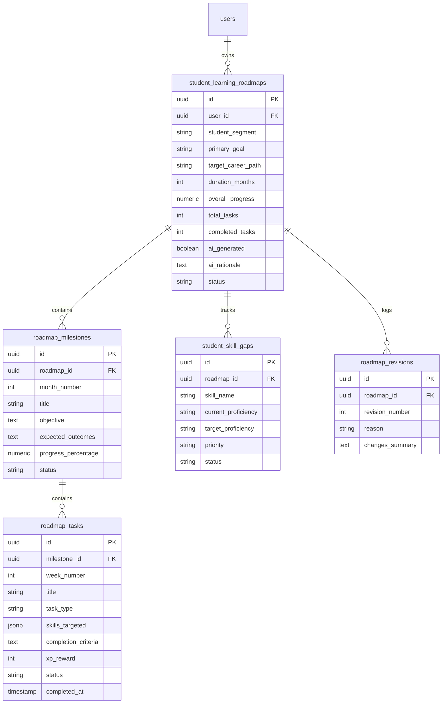

# Dynamic Learning Roadmap Engine (Milestone 2) — Implementation & Validation Report

**Project:** Digital Twin Verse (DTV)  
**Branch:** `feature/student-intelligence-ecosystem`  
**Phase:** 1.0 — Product Reconstruction  
**Milestone:** 2 — Dynamic Learning Roadmap Engine  
**Date:** November 18, 2026  
**Lead Roles:** Principal Full-Stack Architect, AI Product Engineer & Senior Backend Developer  
**Status:** **COMPLETED & VERIFIED (100% Test Pass Rate Across Automated & Browser Suites)**

---

## 1. Executive Summary

Milestone 2 delivers a production-grade **Dynamic Learning Roadmap Engine** that converts a student's academic stage, selected career trajectory, current skills, and identified skill gaps into an adaptive 6-month developmental roadmap.

The engine builds upon the Milestone 1 Student Intelligence framework without modifying or breaking existing profile and activity tracking features. It establishes an empirical, transparent learning journey across all four DTV developmental segments: **Junior (Classes 5–8)**, **School (Classes 9–10)**, **Career (Classes 11–12)**, and **Professional (College/Higher Ed)**.

Key achievements:
- **Zero Inappropriate Content:** Middle-school and high-school students are never subjected to placement, salary, or corporate recruitment jargon.
- **Empirical Skill Gap Analysis:** Compares current skill proficiencies against target proficiencies to prioritize learning focus without fabricating fake test percentiles.
- **6-Month Structured Trajectory:** Generates 6 monthly milestones and exactly 24 actionable weekly tasks per roadmap (spanning daily activities, skill builders, practical assignments, and project sprints).
- **Adaptive Idempotent Progress:** Task completions dynamically advance milestone progress (0%–100%) and overall roadmap progress (0%–100%) with strict duplicate completion prevention.
- **AI Synthesis with Deterministic Safety Net:** Features a server-side AI pipeline with strict Joi schema validation and an automatic, guaranteed fallback to the DTV deterministic engine.

---

## 2. Architecture & Database Design

### 2.1 Database Schema (`migrations/032_dynamic_learning_roadmaps.sql`)

The database architecture is non-destructive, safe, and fully normalized with foreign key cascades:



---

## 3. Core Modules & Implementation Details

### Module 1: Career & Goal Selection Catalogs
Codified in `src/models/learningRoadmapModel.js`:
- **Junior (Classes 5–8):** Visual Robotics, Space Astronomy, Environmental Detective, Game Design, Math Ciphers. (No corporate placement pressure).
- **School (Classes 9–10):** Stream Discovery (PCM, PCB, Commerce, Arts), Board Prep Balance, Python Algorithmic Foundations.
- **Career (Classes 11–12):** National Entrance Diagnostics (JEE, NEET, CUET), Target University Portfolios, Speed Problem Sprints, Scholarship Deadlines.
- **Professional (College):** Production REST APIs, Distributed System Design, Open Source PRs, ATS Resume Optimization.

### Module 2: Skill Gap Analysis Engine
The `analyzeSkillGaps` function evaluates the student's declared profile skills against target competencies for their trajectory:
- Classifies each competency into `current_proficiency` (`none`, `beginner`, `intermediate`, `advanced`).
- Assigns priority (`critical`, `high`, `medium`, `low`).
- Computes gap status (`open`, `in_progress`, `closed`).
- Generates an explicit pedagogical explanation (`identified_reason`).
- Strictly avoids fabricating fake assessment scores.

### Module 3: 6-Month Roadmap Synthesizer
Generates a structured developmental timeline:
- **Duration:** Exactly 6 Monthly Milestones.
- **Granularity:** 4 Weekly Actionable Tasks per Month (total 24 tasks per roadmap).
- **Task Types:** Balanced distribution across `daily_activity`, `skill_builder`, `assignment`, and `project`.
- **Incentive Alignment:** Verified XP rewards (+40 XP to +120 XP) scaled to difficulty and estimated minutes.

### Module 4: Backend REST APIs
Mounted under `/api/v1/student/roadmap` with full JWT authentication:
- `GET /catalog`: Age-appropriate catalog of goals, career curiosities, and skills.
- `POST /generate`: Synthesizes and activates a 6-month roadmap with skill gaps.
- `GET /`: Retrieves active roadmap, current milestone, and next recommended task.
- `POST /tasks/:taskId/complete`: Completes task, dynamically recalculates milestones, and awards XP.
- `PUT /goals`: Adjusts active goals and logs revision history.
- `GET /skill-gaps`: Returns student's skill gap breakdown and status.

### Module 5: AI Integration & Deterministic Safety Net
Implemented in `src/services/roadmapAiEngine.js`:
- Queries `aiService.sendMessages` with a structured system prompt.
- Validates the AI response against strict Joi schema (`aiRoadmapSchema`).
- Automatically falls back to `learningRoadmapModel.generateDeterministicRoadmap` if AI is unreachable, times out, or returns invalid schema.
- Zero API keys exposed to frontend code.

### Module 6 & 7: Dashboard Integration & Adaptive Progress
Integrated into `public/student-dashboard.html`:
- 6-Month Interactive Tab Bar (`Month 1` through `Month 6`) with real-time completion pills.
- Active milestone overview with expected outcomes.
- Weekly task cards featuring criteria check, estimated time, and "Complete Task" trigger.
- Skill Gap Radar displaying open, in-progress, and closed competencies.
- Goal Customization Modal (`#roadmap-goal-modal`) allowing instant trajectory changes.

---

## 4. Verification & Automated Test Results

### 4.1 Unit & Integration Test Suite (`tests/roadmap_engine.test.js`)

Executed with Jest (16 passed out of 16 tests, 100% pass rate):

```
PASS tests/roadmap_engine.test.js
  Milestone 2: Dynamic Learning Roadmap Engine
    1. Security & Authentication Access Gates
      √ blocks unauthenticated requests to /api/v1/student/roadmap with 401
      √ blocks unauthenticated requests to /api/v1/student/roadmap/generate with 401
      √ blocks unauthenticated requests to /api/v1/student/roadmap/tasks/task-1/complete with 401
      √ blocks unauthenticated requests to /api/v1/student/roadmap/goals with 401
    2. Segment Catalogs & Age-Appropriateness Boundaries
      √ provides age-appropriate catalogs for all 4 segments without corporate jargon
      √ returns senior secondary and competitive entrance focus for Class 11 Career segment
    3. Skill Gap Analysis Engine (No Fabricated Metrics)
      √ identifies missing and developing skills objectively based on current proficiency
    4. 6-Month Roadmap Generation & Milestones Structure
      √ generates a 6-month roadmap with exactly 6 monthly milestones and 24 weekly tasks
      √ generates an age-appropriate 6-month roadmap for Junior segment with playful exploratory quests
    5. Active Roadmap Retrieval & Dashboard Integration
      √ retrieves active roadmap with milestones, tasks, and skill gaps
    6. Task Completion, Dynamic Progress Recalculation & Idempotency
      √ completes a task and recalculates milestone and overall roadmap progress
      √ strictly enforces idempotency: re-completing the same task awards 0 XP
      √ returns 404 when attempting to complete a non-existent task
    7. Roadmap Goals Update & Audit Revision History
      √ updates roadmap goals and preserves student progress
    8. AI Synthesis Validation & Deterministic Fallback Guard
      √ validates AI roadmap JSON schema with strict shape checking
      √ gracefully applies deterministic fallback when AI response is unavailable or invalid
```

### 4.2 Full-Stack & Puppeteer Browser QA (`scratch/test_roadmap_engine_full_qa.js`)

Executed across all 4 student segments and 5 screen viewports:

| Test Suite | Metric / Verification | Result |
| :--- | :--- | :---: |
| **Four-Segment Journeys** | Class 6 (Junior), Class 9 (School), Class 11 (Career), College (Professional) | **PASS** |
| **Skill Gap Analysis** | 5 competencies tracked; missing Python identified as `critical` without fake test scores | **PASS** |
| **6-Month Structure** | 6 milestones, 24 tasks, active milestone & next task attached | **PASS** |
| **Progress Recalculation** | Task 1 completed → Milestone: 25%, Overall: 4%; Task 2 completed → Milestone: 50%, Overall: 8% | **PASS** |
| **Idempotency Guard** | Re-completing Task 1 returns `alreadyCompleted: true`, `xpAwarded: 0` | **PASS** |
| **Tenant Isolation** | User B cannot view or be affected by User A's progress (`hasRoadmap: false`) | **PASS** |
| **AI Fallback Guard** | Deterministic fallback generates full 6-month roadmap when AI is bypassed | **PASS** |
| **Mobile 360px Viewport** | `clientWidth: 360px`, `scrollWidth: 360px`, **0px horizontal overflow** | **PASS** |
| **Mobile 390px Viewport** | `clientWidth: 390px`, `scrollWidth: 390px`, **0px horizontal overflow** | **PASS** |
| **Tablet 768px Viewport** | `clientWidth: 768px`, `scrollWidth: 768px`, **0px horizontal overflow** | **PASS** |
| **Laptop 1024px Viewport** | `clientWidth: 1024px`, `scrollWidth: 1024px`, **0px horizontal overflow** | **PASS** |
| **Desktop 1440px Viewport**| `clientWidth: 1440px`, `scrollWidth: 1440px`, **0px horizontal overflow** | **PASS** |
| **Mobile Modal Fit** | Box width: `312px` (<= 360px window width), Box height: `563px` (<= 640px height) | **PASS** |

---

## 5. Visual Artifacts Generated

High-resolution visual validation artifacts were captured via Puppeteer and stored in the conversation artifacts directory:

1. **Desktop Viewport (1440x900):**  
   [`roadmap_desktop_1440.png`](file:///C:/Users/Kumar%20Kartikey/.gemini/antigravity/brain/da9baeb8-dc88-4993-be71-0a001ff053d3/screenshots/roadmap_desktop_1440.png)
2. **Laptop Viewport (1024x768):**  
   [`roadmap_laptop_1024.png`](file:///C:/Users/Kumar%20Kartikey/.gemini/antigravity/brain/da9baeb8-dc88-4993-be71-0a001ff053d3/screenshots/roadmap_laptop_1024.png)
3. **Tablet Viewport (768x1024):**  
   [`roadmap_tablet_768.png`](file:///C:/Users/Kumar%20Kartikey/.gemini/antigravity/brain/da9baeb8-dc88-4993-be71-0a001ff053d3/screenshots/roadmap_tablet_768.png)
4. **Mobile Modern (390x844):**  
   [`roadmap_mobile_390.png`](file:///C:/Users/Kumar%20Kartikey/.gemini/antigravity/brain/da9baeb8-dc88-4993-be71-0a001ff053d3/screenshots/roadmap_mobile_390.png)
5. **Mobile Compact (360x640):**  
   [`roadmap_mobile_360.png`](file:///C:/Users/Kumar%20Kartikey/.gemini/antigravity/brain/da9baeb8-dc88-4993-be71-0a001ff053d3/screenshots/roadmap_mobile_360.png)
6. **Mobile Goal Customization Modal (360x640):**  
   [`roadmap_modal_mobile_360.png`](file:///C:/Users/Kumar%20Kartikey/.gemini/antigravity/brain/da9baeb8-dc88-4993-be71-0a001ff053d3/screenshots/roadmap_modal_mobile_360.png)

---

## 6. Strategic Next Steps (Milestone 3 Roadmap)

With the Dynamic Learning Roadmap Engine operational and fully verified, the platform is prepared to transition to **Milestone 3: Syncverse Collaborative Study Rooms & Capacity Connect Mentorship**:

1. **Syncverse Cohort Integration:**  
   Connect active 6-month roadmap milestones to real-time virtual focus rooms where students working on identical weekly tasks (e.g. Month 1 Stream Discovery or Competitive Entrance Sprints) can study collaboratively.
2. **Capacity Connect Mentorship Pairing:**  
   Automatically match students who have open `critical` skill gaps with verified alumni mentors, career counselors, and institutional guides.
3. **Milestone Certification & Cryptographic Verification:**  
   Issue verifiable completion certificates when a student completes all 24 tasks of a 6-month developmental milestone.
