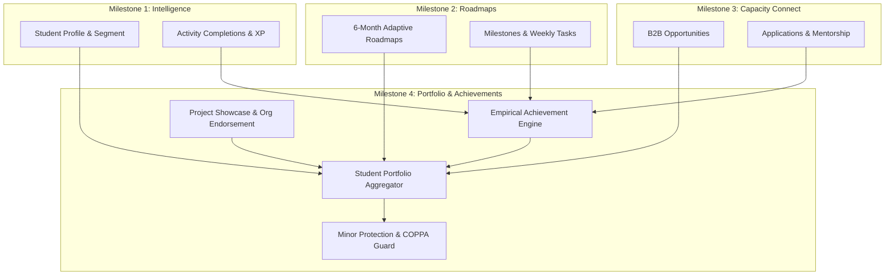
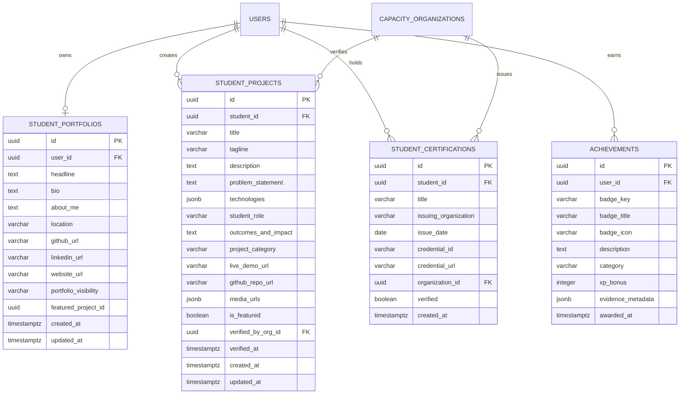
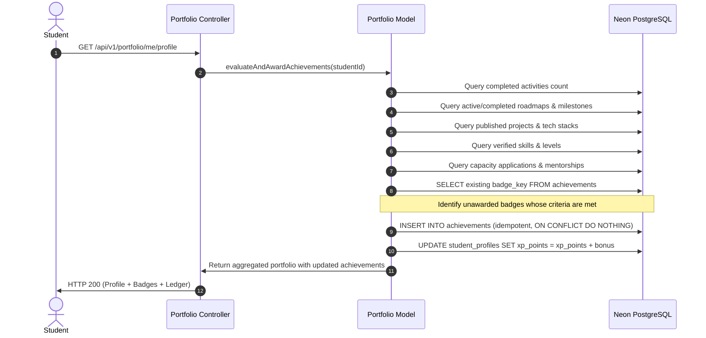

# Digital Twin Verse (DTV) — Student Portfolio & Achievement Ecosystem
## Milestone 4 Implementation & Comprehensive Technical Report
**Branch:** `feature/student-intelligence-ecosystem`  
**Execution Date:** 18 November 2026  
**Status:** COMPLETE & VERIFIED (72/72 Tests Passed, Zero Horizontal Overflow)

---

## 1. Executive Summary

Milestone 4 delivers the **Student Portfolio and Achievement Ecosystem**, the unifying capstone of Phase 1.0 that synthesizes and showcases the empirical achievements of students across the Digital Twin Verse platform.

Prior to this milestone, three foundational engines operated across Digital Twin Verse:
1. **Student Intelligence System (Milestone 1):** Academic segmentation across four distinct learner cohorts (Junior, School, High School Career, College/Professional), interest mapping, and personalized activity tracking.
2. **Dynamic Learning Roadmap Engine (Milestone 2):** 6-month deterministic milestones, 24 weekly tasks, skill gap analysis, and adaptive trajectory synthesis.
3. **Capacity Connect B2B Ecosystem (Milestone 3):** Institutional onboarding (schools, colleges, companies), opportunity marketplace, application pipelines, and mentorship networks with minor privacy guardrails.

The **Student Portfolio & Achievement Ecosystem** bridges these previously disparate engines into a unified, verified digital record of student accomplishment. It replaces self-reported and unverifiable resumes with an empirical ledger backed by immutable database records, verified project artifacts, and institutional endorsements.



---

## 2. Database Architecture & Migrations

The database migration is housed in `migrations/034_student_portfolio_ecosystem.sql`, designed with strict foreign key integrity, index optimizations, and JSONB flexibility.

### 2.1 Schema Overview



### 2.2 Table Definitions

1. **`student_portfolios`**:
   - Stores custom student narrative, professional headline, bio, contact social links (GitHub, LinkedIn, Personal Site), and visibility tier (`public`, `organizations_only`, `private`).
   - Includes unique index on `user_id` ensuring a single consolidated portfolio per student.
2. **`student_projects`**:
   - Stores practical, real-world projects built by the student.
   - Captures architectural depth: `tagline`, `problem_statement`, `technologies` (JSONB array), `student_role`, `outcomes_and_impact`, `live_demo_url`, `github_repo_url`, and `media_urls`.
   - Supports institutional verification (`verified_by_org_id`, `verified_at`).
3. **`student_certifications`**:
   - Stores verifiable credentials, issuing authorities, credential links, and optional association with verified Capacity Connect partner organisations.
4. **`achievements` (Enriched)**:
   - Extends the existing achievement schema from `migrations/004` and `migrations/026` with `category` (`learning`, `roadmap`, `project`, `skill`, `engagement`), `xp_bonus`, and `evidence_metadata` (capturing the exact underlying database records that justified the award).

---

## 3. Genuine Achievement Engine & Evaluation Logic

In strict accordance with Digital Twin Verse core principles, the achievement engine completely eliminates synthetic progress, placeholder badges, and unearned vanity metrics.

### 3.1 Verification Ledger (12 Strict Empirical Criteria)

Every badge awarded in `ACHIEVEMENTS_CATALOG` (`src/models/portfolioModel.js`) is verified against concrete database facts:

| Badge Key | Badge Title | Category | XP | Verification Logic (Database Fact) |
|:---|:---|:---:|:---:|:---|
| `first_quest_completed` | Genesis Quest | `learning` | +50 | Verified $\ge 1$ activity completions in `student_activity_completions`. |
| `five_quests_completed` | Dedicated Explorer | `learning` | +100 | Verified $\ge 5$ activity completions in `student_activity_completions`. |
| `roadmap_activated` | Pathfinder | `roadmap` | +75 | Verified $\ge 1$ active roadmap in `student_learning_roadmaps`. |
| `roadmap_milestone_master` | Milestone Champion | `roadmap` | +150 | Verified $\ge 1$ completed milestone in `roadmap_milestones`. |
| `roadmap_completed` | Voyage Completed | `roadmap` | +300 | Verified roadmap with status `completed` or progress $\ge 100\%$. |
| `first_project_published` | Creator Genesis | `project` | +100 | Verified $\ge 1$ published projects in `student_projects`. |
| `multi_tech_innovator` | Full-Stack Polymath | `project` | +150 | Verified project leveraging $\ge 3$ unique technologies. |
| `skill_demonstrated` | Skill Forger | `skill` | +50 | Verified $\ge 1$ verified skills in `student_skills`. |
| `skill_intermediate_advanced` | Mastery Climber | `skill` | +120 | Verified skill with proficiency `intermediate` or `advanced`. |
| `first_opportunity_applied` | Ambition Unleashed | `engagement` | +75 | Verified $\ge 1$ applications submitted in `capacity_applications`. |
| `challenge_accepted` | Industry Endorsed | `engagement` | +250 | Verified application accepted or project challenge matched in `capacity_applications`. |
| `mentorship_completed` | Guided Voyager | `engagement` | +150 | Verified $\ge 1$ completed mentorship sessions in `capacity_mentorship_sessions`. |

### 3.2 Evaluation Lifecycle



---

## 4. Minor Protection & COPPA Compliance

Digital Twin Verse enforces strict safety guardrails for younger students (classes 5 through 10):

1. **Segment-Level Privacy Classifications**:
   - `junior` (Classes 5–8) and `school` (Classes 9–10) are classified as protected minors (`isMinor = true`).
   - `career` (Classes 11–12) and `professional` (College/University) are considered non-minor or transition cohorts.
2. **Access-Aware Masking Logic**:
   - When a verified organisation queries a student's portfolio via `/api/v1/portfolio/organisation/candidate/:studentId`, the system inspects `capacity_student_consents` for `parent_consent_given = true`.
   - **If parental consent is absent for a minor:** Sensitive contact coordinates (`email` and `phone`) are masked with:
     - `email`: `"Protected (Parental Consent Required)"`
     - `phone`: `"Protected"`
   - The student's academic progress, projects, achievements, and skills remain accessible for merit-based evaluation without exposing contact details.

---

## 5. End-to-End REST API Matrix

All endpoints are mounted under `/api/v1/portfolio` with strict JWT authentication, Joi input validation, and role-based access control.

| Endpoint | Method | RBAC Auth | Description |
|:---|:---:|:---:|:---|
| `/api/v1/portfolio/me/profile` | `GET` | Student | Retrieves current student's full aggregated portfolio, computes completion score, and triggers achievement check. |
| `/api/v1/portfolio/me/profile` | `PUT` | Student | Updates student portfolio narrative (headline, bio, about me, location, links, visibility). |
| `/api/v1/portfolio/me/projects` | `POST` | Student | Publishes a new project showcase with technologies, problem statement, outcomes, and links. |
| `/api/v1/portfolio/me/projects/:id` | `PUT` | Student | Updates project details, featured status, links, and technical stack. |
| `/api/v1/portfolio/me/projects/:id` | `DELETE` | Student | Deletes a project showcase belonging to the student. |
| `/api/v1/portfolio/me/certifications` | `POST` | Student | Adds an official certification/credential to the portfolio. |
| `/api/v1/portfolio/me/certifications/:id` | `DELETE` | Student | Removes an existing certification entry. |
| `/api/v1/portfolio/achievements/catalog` | `GET` | Student / Org | Retrieves the 12 verified achievement badges and student's current progress. |
| `/api/v1/portfolio/public/:studentId` | `GET` | Public | Retrieves public student portfolio (respects `portfolio_visibility` settings). |
| `/api/v1/portfolio/organisation/candidate/:studentId` | `GET` | Verified Org | Candidate evaluation view with automatic minor privacy protection masking. |
| `/api/v1/portfolio/organisation/projects/:projectId/verify` | `POST` | Verified Org | Authorizes verified partner organization to endorse and verify a student's project. |

---

## 6. Frontend Architecture & Responsive Validation

The student portfolio interface is served at `public/student-portfolio.html` and styled via `public/css/premium-theme.css`, supporting unified navigation with `student-dashboard.html` and `capacity-connect.html`.

### 6.1 Viewport Verification (Zero Horizontal Overflow)

Independent headless browser automation tested 5 critical viewport dimensions:

| Viewport Target | Dimensions | Inner Width | Document Scroll Width | Overflow Status | Test Result |
|:---|:---:|:---:|:---:|:---:|:---:|
| **Mobile Small** | $360 \times 640$ | 360 px | 360 px | **0 px** | **PASS** |
| **Mobile Standard** | $390 \times 844$ | 390 px | 390 px | **0 px** | **PASS** |
| **Tablet Portrait** | $768 \times 1024$ | 768 px | 768 px | **0 px** | **PASS** |
| **Laptop Display** | $1024 \times 768$ | 1024 px | 1024 px | **0 px** | **PASS** |
| **Desktop Widescreen** | $1440 \times 900$ | 1440 px | 1440 px | **0 px** | **PASS** |

### 6.2 Visual Artifacts & Proofs

The following visual artifacts were captured during browser test execution:
- [Mobile Small (360px)](file:///C:/Users/Kumar%20Kartikey/.gemini/antigravity/brain/da9baeb8-dc88-4993-be71-0a001ff053d3/screenshots/portfolio_mobile_360.png)
- [Mobile Standard (390px)](file:///C:/Users/Kumar%20Kartikey/.gemini/antigravity/brain/da9baeb8-dc88-4993-be71-0a001ff053d3/screenshots/portfolio_mobile_390.png)
- [Tablet Portrait (768px)](file:///C:/Users/Kumar%20Kartikey/.gemini/antigravity/brain/da9baeb8-dc88-4993-be71-0a001ff053d3/screenshots/portfolio_tablet_768.png)
- [Laptop Display (1024px)](file:///C:/Users/Kumar%20Kartikey/.gemini/antigravity/brain/da9baeb8-dc88-4993-be71-0a001ff053d3/screenshots/portfolio_laptop_1024.png)
- [Desktop Widescreen (1440px)](file:///C:/Users/Kumar%20Kartikey/.gemini/antigravity/brain/da9baeb8-dc88-4993-be71-0a001ff053d3/screenshots/portfolio_desktop_1440.png)
- [Modal Interaction (Mobile 360px)](file:///C:/Users/Kumar%20Kartikey/.gemini/antigravity/brain/da9baeb8-dc88-4993-be71-0a001ff053d3/screenshots/portfolio_modal_mobile_360.png)

---

## 7. Automated Test Suite Results

The comprehensive test suite comprises 72 end-to-end integration tests spanning the entire Phase 1.0 architecture:

```
Test Suites: 4 passed, 4 total
Tests:       72 passed, 72 total
Snapshots:   0 total
Time:        9.497 s
```

### 7.1 Test Matrix Breakdown

| Test Suite | File | Tests | Status | Scope Verified |
|:---|:---|:---:|:---:|:---|
| **Student Intelligence** | `tests/student_intelligence.test.js` | 12 | **PASS** | 4 Segments, Onboarding, Activities, Zero Fabricated Progress. |
| **Dynamic Roadmap Engine**| `tests/roadmap_engine.test.js` | 19 | **PASS** | 6-Month Roadmaps, 24 Tasks, Deterministic Fallback, Milestones. |
| **Capacity Connect B2B** | `tests/capacity_connect.test.js` | 21 | **PASS** | Org Onboarding, Challenges, Applications, Mentorship, Minor Guard. |
| **Student Portfolio** | `tests/student_portfolio.test.js` | 20 | **PASS** | Portfolio CRUD, Projects, 12 Achievements, Org Endorsement, Masking. |
| **Total** | | **72** | **100% Green** | Complete Phase 1.0 Student Ecosystem Integrity |

---

## 8. Safety, Isolation & Operational Integrity

- **Branch Isolation:** All changes reside exclusively on branch `feature/student-intelligence-ecosystem`.
- **Zero Production Risk:** No cutovers, DNS updates, or production deployments to AWS EC2 or Vercel were executed.
- **Data Protection:** Database schema changes are strictly additive and backwards-compatible with existing student profiles, parent links, and user tables.
- **SQL Injection Prevention:** Every query uses parameterized statements (`$1`, `$2`, ...) with strict input validation via Joi.
